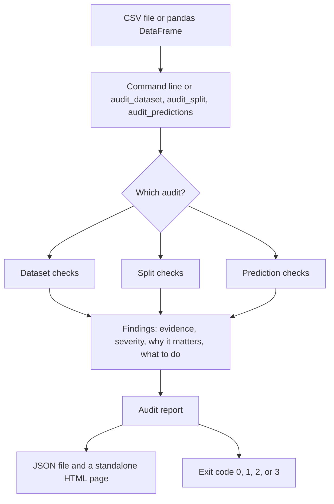

# Mlpipelinecheck

Mlpipelinecheck is a local Python library that audits tabular datasets, explicit train/test splits, and supplied predictions. It reports evidence-backed findings and can fail a command when a configured severity gate matches.

It does not prove that a model or a split is free of leakage. Heuristic signals are labeled as such. The package does not train estimators, send data over the network, or include raw rows in reports.

This repository is the 0.2.0 implementation described in `EvalGuard_PRD.md`, published under the name `mlpipelinecheck`. Install it with:

```bash
python -m pip install mlpipelinecheck
```

`pip install evalguard` installs a different project: https://pypi.org/project/evalguard/ is an agent-output validator owned by another account.

A local checkout, including the tests, installs with `python -m pip install -e ".[dev]"`. Version 0.2.0 is on PyPI and on TestPyPI. The repository is https://github.com/HIMANSHUMOURYADTU/mlpipelinecheck.

Python 3.10+ is required. GitHub Actions passed on Python 3.10, 3.11, and 3.12.

## Quick start

```python
import pandas as pd
from mlpipelinecheck import audit_dataset

df = pd.DataFrame(
    {
        "age": [25, 40, 33, 52],
        "plan": ["a", "b", "a", "b"],
        "churn": [0, 1, 0, 1],
    }
)
report = audit_dataset(df, target="churn", task="classification")
print(report.summary()["status"])
report.to_json("dataset_audit.json")
report.to_html("dataset_audit.html")
```

See `docs/quickstart.md` for regression, grouped splits, and temporal splits.

## Command line

```bash
mlpipelinecheck audit-dataset data.csv --target target --task classification --html report.html --json report.json
mlpipelinecheck audit-split train.csv test.csv --target target --task classification --group-column customer_id --html split-report.html
mlpipelinecheck audit-predictions predictions.csv --target true --prediction-column pred --task regression --html predictions-report.html
```

Exit codes: `0` no configured gate breach, `1` the gate matched, `2` invalid input or a check that could not be completed, `3` internal error. The default gate is severity `high`.

## How a check runs

One call does one job. You choose a dataset audit, a split audit, or a prediction audit. The library does not decide which file is the test set, and it does not train a model.



Open `docs/architecture.html` in a browser for the same picture as a single page. GitHub shows that file as source. The picture above is the one rendered on this README.

The path inside the package is short:

1. The command-line parser, or your Python call, builds an `AuditConfig`. Configuration files are JSON. There is no YAML dependency.
2. The frame checks reject a non-table, duplicate column names, and a missing target, group, time, or feature column.
3. `checks/dataset.py`, `checks/split.py`, or `checks/metrics.py` runs the rules for that audit. Each rule comes from `rules.py`.
4. A finding stores evidence, severity, confidence, why it matters, a recommended action, and the limits of that check. Row contents and group ids are left out of the report. Column names and class names stay, because the counts cannot be read without them.
5. `AuditReport` can write JSON through the standard library, or HTML through `html.escape`. The HTML page does not load a template package or a network asset.
6. The severity gate counts findings at or above the chosen level. The default level is `high`. If a check errors, the command exits 2 even when a finding would also have failed the gate.

## What it is built with

| Piece | Role |
|---|---|
| Python 3.10+ | The language the library runs on |
| pandas | Holds the tables you pass in. The frames are not rewritten |
| numpy | Numeric comparisons and the optional resample |
| scikit-learn | Accuracy, F1, ROC AUC, log loss, Brier score, MAE, MSE, and R². The library calls these. It does not refit a model |
| Standard library `json`, `html`, `argparse`, and hashing | Reports, the command line, and row fingerprints |
| pytest and ruff | Tests and lint, installed with the `dev` extra |
| setuptools, build, and twine | Packaging and the upload check |
| GitHub Actions | Runs lint, tests, a small benchmark, and the severity gate on Python 3.10, 3.11, and 3.12 |

Nothing in the audit path sends the table to a service. A quiet report means these checks found nothing. It does not mean the evaluation is safe.

## Scope

In version 0.2:

- dataset checks for emptiness, missing values, exact duplicates, constant and near-constant features, a high-cardinality heuristic, target-in-features, exact target copies, class imbalance, and non-finite numbers
- split checks for schema, exact row overlap, within-partition duplicates, group overlap, temporal order, class and numeric distribution differences, small test partitions, and target problems
- prediction metrics for classification and regression, with input validation

Prediction audits can request an iid percentile interval with `bootstrap_samples`. Grouped and temporal intervals are refused rather than replaced with an iid interval. Correlation-based target proxies, notebook or repository scanning, dashboards, hosted services, and model training are not included.

## Synthetic benchmark

`python benchmarks/synthetic_cases.py --write` reruns the development fixtures and writes `benchmarks/RESULTS.md`. Those fixtures were used while the detectors were written. On that list, structural checks had 17 true positives, 0 false positives, and 0 false negatives. Heuristic checks had 4 true positives, 0 false positives, and 0 false negatives. A precision of 1.000 there means those fixtures matched their labels.

`python benchmarks/heldout_cases.py --write` scores a separate list whose labels were assigned from the construction and the documented thresholds. On Python 3.11.9 it reported structural micro counts n=193, tp=17, fp=0, fn=0, tn=176 (precision 1.000, recall 1.000, false-positive rate 0.000) and heuristic micro counts n=44, tp=4, fp=0, fn=0, tn=40 (precision 1.000, recall 1.000, false-positive rate 0.000). `METRIC.WIDE_CONFIDENCE_INTERVAL` (n=3, tn=3) and `SPLIT.SMALL_TEST_PARTITION` (n=9, tn=9) have undefined precision and recall because they have no positive cases on this list. A doubled target column and a legitimately correlated score produced no exact-copy finding; no rule claims those patterns. This is not field performance. The tables are in `benchmarks/heldout_RESULTS.md`.

The same local run recorded development-list wall time of 0.178s for a 2,000-row dataset audit and 0.716s for 10,000 rows. The matching split audits took 0.321s and 1.691s. Peak traced Python allocations were 420,977 and 1,880,049 bytes for the dataset audits, and 347,980 and 2,403,172 bytes for the split audits.

## Documentation

- `docs/architecture.html`
- `docs/quickstart.md`
- `docs/api.md`
- `docs/cli.md`
- `docs/rules.md`
- `docs/ci.md`
- `docs/privacy.md`
- `docs/limitations.md`
- `docs/troubleshooting.md`
- `docs/publishing.md`
- `docs/implementation_notes.md`
- `benchmarks/README.md`
- `CONTRIBUTING.md`
- `CHANGELOG.md`

## Citation

There is no DOI. Cite this release as:

mlpipelinecheck contributors. (2026). mlpipelinecheck (Version 0.2.0) [Computer software]. https://github.com/HIMANSHUMOURYADTU/mlpipelinecheck

Do not cite https://pypi.org/project/evalguard/ for this software. That page is the other project.

## License

MIT. See `LICENSE`.
